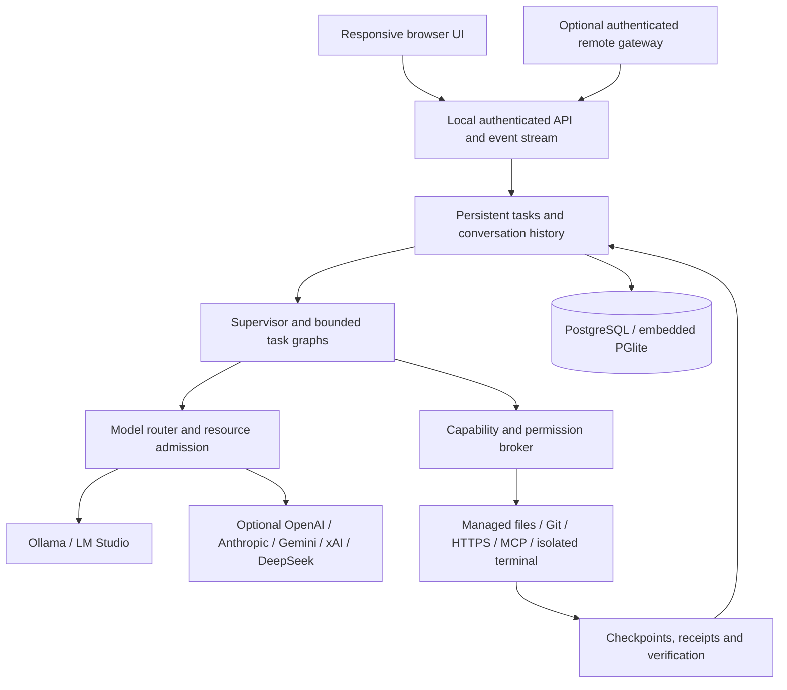

# Relay

### AI that works on your computer, under your control.

Relay is a local-first AI execution platform with a browser interface. Give it an objective, choose its access and budget, and follow the work from model selection through tools, approvals, changes and verification.

Run it with local models alone, or explicitly connect cloud providers. Your host remains responsible for permissions, resource admission and execution. Remote access is optional.

**Models propose. The orchestrator decides. Tools execute. Reality verifies.**

[Get started](#get-started) · [User guide](docs/user-guide.md) · [Architecture](docs/architecture.md) · [Security](docs/security-model.md) · [Validation](docs/validation.md)

[0.1.2 release report: changes, verification and remaining work](docs/release-0.1.2.md)

The modernization branch now targets **0.1.3**. Its Model Studio separates model inspection, connection management and deliberate measurement, with exact model IDs and explicit unknown evidence. See the [0.1.3 acceptance ledger](docs/final-evolution/acceptance-0.1.3.md). This is a development version; the final platform directive remains incomplete.

The `modernization/final-evolution` branch is continuing the [final evolution plan](docs/final-evolution/master-plan.md). It includes the Studio shell, Execution Workbench, focused approvals and a rebuilt Projects workspace, plus verified reliability/security and native development-environment improvements. It is not a completed release: [requirements](docs/final-evolution/requirements-matrix.md), [acceptance evidence](docs/final-evolution/acceptance-results.md) and the [continuation ledger](docs/final-evolution/continuation.md) distinguish working increments from unfinished capabilities. Production is not upgraded by a branch push.

The modernization Projects view also provides local-owner [isolated Git branch workspaces](docs/managed-branches.md) from current managed files. These retain separate files and permissions, including verified relocation during encrypted embedded restore. Original-source branch import, merging/publication and automatic interrupted-registration recovery remain open.

> **Project status:** Relay is a working, actively developed application. The repository includes persistent tasks, local inference, controlled tools and a responsive interface. Some host integrations and deployment paths still need native validation; arbitrary native command execution and signed installers are not available. See [Current boundaries](#current-boundaries) before choosing a deployment.

## What you can do

| Workflow | What Relay provides |
| --- | --- |
| Have a conversation | Stream answers, reopen saved conversations, search history and navigate older messages. |
| Bring your files | Attach or drag text/code, PDF and modern Word files into a private workspace. Documents import a text copy; originals remain unchanged. |
| Work on a project | Import a managed copy, authorize file tools, inspect changes and restore recorded checkpoints when safe. |
| Coordinate agents | Use bounded worker, planner, specialist and reviewer graphs. Agents and their assigned models are separate concepts. |
| Choose available intelligence | Discover local and authorized cloud models; choose provider, model and supported reasoning, or let Auto weigh task needs and known cost. [Selection and limits](docs/model-selection.md). |
| Inspect token usage | Open the Usage side panel for your recorded tokens and last-observed provider rate limits, where reported. |
| Respect the computer | Inspect real hardware, assess model fit, reserve memory headroom and collect local performance samples. |
| Inspect execution | Follow factual activity, tool requests, approvals, model assignments and verification receipts. |
| Get completion alerts | See in-app completion notices and opt into private browser notifications while Relay remains open. |
| Research with controlled tools | Allow selected public HTTPS origins, inspect managed-workspace Git changes, or pin approved MCP tool contracts. |
| Share a host deliberately | Configure an optional authenticated remote gateway, then grant each user specific models, workspaces, budgets and capabilities. |

No cloud account is required. Local inference needs a running supported runtime and an installed model; Relay does not ship model weights.

## 0.1.2 · Controlled execution, clearer evidence

- **Connected model selection:** open the model drawer, choose your connected provider and model, then choose supported reasoning effort. Auto considers authorized cloud models only when task privacy allows them; known prices and budgets constrain selection. Unknown pricing and missing quality evidence stay explicit.
- **Reliable work:** approval waits have separate accounting and release execution slots. Durable authorization is checked again at tool dispatch. Ordered migrations preserve existing data.
- **Recovery and projects:** encrypted offline backups include referenced artifacts; retention requires an owner preview. Imported projects support exact reviewed text-file additions, deletions and modifications within existing directories, conflict refusal and separately approved content rollback.
- **Useful context and automation:** approved private memory, bounded task-specific agent graphs and local read-only schedules have dedicated controls. Separate Google Workspace consent enables explicitly selected local-only Gmail/Calendar reads.
- **Evidence you can inspect:** task timing, bounded diagnostics and versioned model evaluations report observed results. Executable coding evaluations require a verified container; unavailable environments refuse before model spending.
- **Everyday usability:** conversation-first controls, an Advanced disclosure, clearer execution evidence and responsive drawers are tested from 320px phones through wide desktop layouts.

See the [engineering report and workstream status](docs/evolution-report.md) for remaining work. Version 0.1.2 is an incremental release, not completion of every planned integration or native platform.

## Your host, any browser

Share Relay through a stable HTTPS hostname. People authenticate at Cloudflare Access, then use their own Relay account from a desktop, tablet or phone. **Local inference and in-app agent tools run on your host PC.** External coding clients use a separate model API and execute their own tools on their own computers.

- **Personal accounts:** private conversations, owner-approved access requests, revocable sessions and explicit workspace/model grants.
- **Personal files:** users create private workspaces, upload supported text files, edit, download and delete them. Agent autonomy inside an owned workspace is independent of the owner's shared-folder grants. Supported desktop browsers can connect a device folder, import a reviewed copy and explicitly apply selected changes back. [Files and permissions](docs/personal-files.md).
- **Personal cloud connections:** each user connects their own permitted OpenAI, Anthropic, Gemini, Grok (xAI) or DeepSeek API account. Credentials, model catalogs and provider settings are isolated by user; visitors never borrow the owner's cloud keys. Owners explicitly grant provider access to remote accounts under **Access**.
- **Usage drawer:** use **Usage** in the header, phone navigation or command palette. See today's reported input/output tokens per model. Where OpenAI or Anthropic returns remaining rate-window capacity, the panel shows the observation and reset information. Other balances are labelled unavailable; consumer subscription allowances are not exposed by these API connections. [Usage details](docs/usage.md).
- **Stable address:** use a protected `workers.dev` gateway with a fixed private Tunnel binding, or a named tunnel with your own domain. Keep the Worker name/account subdomain or domain configuration stable across updates. The host must remain awake and connected.
- **Local independence:** an Internet or tunnel outage does not disable the local owner's browser service.
- **LAN accounts:** a separate optional HTTPS listener accepts short-lived, owner-issued account invitations. Being on the Wi-Fi grants no host authority. [LAN setup](docs/lan-access.md).
- **Specialists:** choose Email, Calendar, Research, Coding, File Management, Personal Assistant, Browser, Finance, Learning or Computer. Each profile constrains available tools; it never increases permissions. Personal task lists are persisted per user. [Google Workspace](docs/google-workspace.md) supports explicit read-only Gmail/Calendar access after setup and account consent, including separately selected local-only agent tools. Sending, calendar changes, browser automation and desktop automation remain unavailable.
- **External clients:** expiring account tokens authorize local-model inference without saving external conversation content. Client tool execution stays on the client computer. [API, limits and compatibility](docs/external-clients.md).

**No domain purchase needed for the current free option:** [Cloudflare free setup](docs/cloudflare-free.md) uses a `workers.dev` address, Access email PINs or configured Google login, and Workers VPC. VPC is currently free **in beta**, not a promise of permanent free pricing. The browser Worker does not expose the external inference API. Public deployment and real remote-device acceptance are separate setup steps.

Start in **Access → Remote gateway** on the host. Save the public address, Access issuer and application audience, restart Relay, then enable the gateway after configuring the protected tunnel. [Step-by-step Google login and permanent URL setup →](docs/remote-setup.md)

Google sign-in identifies a Relay user; it does not automatically authorize model inference or another company's subscription. **Gemini supports Connect Google after one-time owner setup**, using a separately authorized quota project. Read the [setup guide](docs/google-connection-setup.md) before enabling shared project usage. Live consent and quota eligibility still require your configured Google application. OpenAI's eligible local/open-source ChatGPT sign-in needs a separate Relay adapter and shared-host eligibility review; Anthropic, xAI and DeepSeek retain supported API-key connections. [Provider sign-in research](docs/research-provider-signin.md). Gmail/Calendar agent access requires separate connectors. The development host has a deployed authenticated Worker and a verified remote session; new installations require their own account and deployment configuration.

## Get started

### 1. Get the project

Clone [YardenNitsan/Relay](https://github.com/YardenNitsan/Relay), or download and extract its source archive. Open a terminal in the `Relay` directory.

```sh
git clone https://github.com/YardenNitsan/Relay.git
cd Relay
```

### 2. Start Relay

**Windows** — run [setup.cmd](setup.cmd), or double-click it:

```powershell
.\setup.cmd
```

**Linux / macOS** — run [setup.sh](setup.sh):

```sh
sh setup.sh
```

For a new host, the shared setup prepares dependencies and compiled assets before starting the local service. An already-running Relay host is reused without rebuilding or interrupting its tasks; stop it before applying pending source updates. Setup can prepare a project-local Node.js runtime when a suitable Node installation is missing. Initial setup needs Internet access to download missing dependencies; a prepared installation can operate offline with local models.

The browser address is **http://127.0.0.1:4317**. Setup opens the browser and a protected file containing a one-use pairing code. Enter the file's `token` value in **Connect this browser**. The code expires after five minutes; the resulting local browser session lasts up to twelve hours. A public URL or an open local port is not an owner credential.

| Command | Purpose |
| --- | --- |
| `setup.cmd --check` / `sh setup.sh --check` | Diagnose prerequisites without installing, building, starting or pairing. |
| `setup.cmd --no-browser` / `sh setup.sh --no-browser` | Prepare/start Relay and report the URL and private pairing-file location without opening windows. |
| `setup.cmd --stop` / `sh setup.sh --stop` | Gracefully stop a host started by setup. Separately launched hosts must be stopped through their own terminal or service manager. |

For a restart, stop the setup-managed host and run setup again. **Stop all agents** in the browser stops work; it does not shut down the host service. [Setup behavior, prerequisites and validation →](docs/setup.md)

<details>
<summary>Manual setup with an existing Node.js 24+ installation</summary>

```sh
npm ci
npm run build
npm start
```

Keep that terminal open. In a second terminal in the same directory:

```sh
npm run pair
```

Open the private file reported by the pairing command, then enter the code at http://127.0.0.1:4317. The command reports a file path rather than printing the credential. Use `Ctrl+C` in the host terminal to shut down gracefully. On Windows, use `npm.cmd` if PowerShell blocks the `npm.ps1` launcher.

</details>

### 3. Make a local model available

Start **Ollama** or **LM Studio** with an installed model, then open **Models & providers** in Relay. Opening this panel fetches the installed local catalog from the runtimes; newly downloaded models are not maintained in a static list. Refresh is also available while the panel remains open. Inspect the model and select **Check hardware fit**. Tool work requires a model that reports tool-calling support.

Relay does not automatically install runtimes or download models. Pick a model appropriate for your available memory; a model's weight-file size is only part of its memory requirement. [Local inference details →](docs/local-inference.md)

**LM Studio runs in the background.** Relay starts an installed LM Studio service on localhost:1234 when the host starts. For operation without the desktop app, install LM Studio's official **llmster** once. Open **Models** to refresh both runtime libraries; downloaded chat models appear even when unloaded. Relay uses native memory estimates, chooses a safe GPU/CPU split, loads a private instance with your selected context, and unloads it after the call. Models that cannot fit current memory remain unavailable for that request. See [background setup and memory limits](docs/local-inference.md).

### 4. Send an objective

Start with **Auto model**, **Balanced**, **Read only** and **Local only**:

> Explain how this platform separates an agent from a model.

For file work, choose a workspace and import a managed copy first. Select **Supervised**, then try a small, checkable objective:

> Read the README, identify one unclear setup instruction, and propose a focused correction. After approval, make the change and read the file back.

Open **Activity** to inspect what actually happened. Its **Changes** and **Verification** tabs distinguish recorded modifications and tool evidence from the model's answer. Your original source directory is not modified by the managed-copy workflow.

## How Relay works



The host is a **TypeScript modular monolith on Node.js**, with Fastify for HTTP and server-sent events. The frontend uses React, TypeScript and Vite. Windows, Linux and macOS host adapters handle platform-specific hardware, data directories and secret storage.

By default, backend-local **PGlite** provides PostgreSQL persistence without a separate database service. Set `DATABASE_URL` to use native PostgreSQL. Messages, tasks, steps, calls, approvals and events have structured records; large artifacts and managed workspaces live on disk. Complete history is separate from the bounded context sent to a model.

The orchestration core constructs and validates task graphs, accounts for budgets, records decisions and propagates cancellation. A model cannot grant itself tools, broaden a workspace, disable logging or override emergency stop. [Architecture and decisions →](docs/architecture.md)

## Control the work

| Control | Meaning |
| --- | --- |
| **Fast / Balanced / Deep / Maximum** | Choose the scope of worker, planning, specialist and review work within explicit limits. More depth can take longer and use more model calls. |
| **Auto model / selected model** | Route over currently available, authorized models. A selected model is a preference; safety checks and availability still apply. |
| **Read only / Supervised / Autonomous workspace** | Set the ceiling for computer operations within an authorized managed workspace. |
| **Local only / Ask before sharing / Allow cloud providers** | Decide whether selected context may leave the host for cloud inference. Connecting a provider alone does not grant this. |
| **Execution options** | Bound calls, time, iterations, context and cloud cost; independently configure network origins and MCP access. |
| **Stop all agents** | Latch a host-side stop, cancel managed work and prevent new scheduling until the owner resumes Relay. |

Hardware admission considers RAM, dedicated or unified GPU memory, model weights, KV cache, runtime buffers, concurrent pressure and safety headroom. Missing measurements remain unknown. A safety pause is a meaningful outcome, not a reason to ignore memory limits.

**Auto applies to specialists too.** Agent roles select from the same authorized, hardware-admitted intelligence pool as normal conversations. Selection reasons are recorded in Activity. Owner-run task-fit probes can supply small, verifiable coding/reasoning/extraction observations tied to the installed model artifact; they are not a comprehensive intelligence benchmark. [Routing comparisons and limitations](docs/model-routing-comparison.md).

**Use fewer wasted tokens.** Execution options offer Efficient/Standard and a per-call output ceiling. Efficient requests concise, complete answers and omits tools forbidden by the current access mode. Required verification and evidence are preserved; a truncated answer pauses instead of being presented as finished. [Token policy and research](docs/research-token-efficiency.md).

## Security and privacy

- **Local by default.** Cloud providers and remote access are optional. No Internet service is required for an already prepared local installation and local inference.
- **Authenticated localhost.** One-use owner pairing, expiring cookies, origin/Host validation and CSRF protection guard the local API. The service binds to loopback.
- **Separate permissions.** Account grants, task computer access, cloud sharing, network origins and MCP selections are checked independently on the host.
- **Protected credentials.** Provider keys stay in the backend after entry. Supported OS vaults are Windows Credential Manager, macOS Keychain and Linux Secret Service; explicit session-only storage is also available. Keys are not returned in model catalogs or stored in ordinary database fields.
- **Controlled execution.** Structured tools pass through deterministic policy. Terminal tools require a verified Docker isolation boundary; there is no fallback to unrestricted host shell execution.
- **Untrusted content stays untrusted.** Documents, files, web responses, MCP catalogs and tool results do not become policy authority. These boundaries reduce risk; they do not make arbitrary external text or remote services trustworthy.
- **Recoverable records.** Changes, approvals, events and checkpoints persist. Interrupted actions with uncertain effects require inspection rather than automatic replay.

Remote deployment uses a separate authenticated listener behind Cloudflare Tunnel and Access. **Never expose the owner port, database, model-runtime ports or Docker socket to the Internet.** The remote listener is part of the same host process, not a separate OS security boundary. [Remote setup and threat model →](docs/remote-access.md)

## Current boundaries

Relay's implementation and its validation coverage are different things:

| Area | Current boundary |
| --- | --- |
| Host platforms | Shared core and Windows/Linux/macOS adapters exist. Windows has direct application validation; Linux has recorded native WSL validation of an earlier snapshot. Native macOS and the current cross-platform release still require verification. |
| Packaging | Portable OS archives and startup templates exist. Signed native installers, notarization and automatic updates are not delivered. |
| Computer control | Managed copies and owner-confirmed [direct host file operations](docs/host-access.md) are implemented. Arbitrary native commands remain unavailable; terminal execution stays isolated. |
| Terminal / native database | Actual Windows Docker Desktop and hosted Linux checks cover sandbox isolation, native PostgreSQL upgrades/locking/restore and small Node/Python/.NET programs. Controlled online package restoration and medium application builds remain open. [Evidence](docs/final-evolution/acceptance-results.md). |
| Local inference | Ollama and LM Studio have actual-host execution evidence. Hardware fit is conservative admission, not a peak-memory guarantee; calibration is a bounded throughput sample, not a model-quality benchmark. |
| Coding acceptance | One real local-model trial repaired two seeded faults in a 514-file fixture, passed independent tests and completed reviewed publication/rollback. An identical repeat failed independent grading, so consistent completion remains unproven. Full application builds and Git worktrees remain unfinished. [Both outcomes](docs/final-evolution/benchmark-results.md). |
| Cloud / remote / MCP | Adapters and policy enforcement exist. Public Access sign-in, a healthy tunnel and a real remote session are verified on the development host. Live credentialed cloud inference, full remote task acceptance and broad external MCP interoperability remain separate checks. MCP currently supports constrained anonymous public HTTPS only. |
| Retrieval | Local full-text history search and bounded retrieval from the current conversation exist. Semantic embeddings, automatic conversation summaries and arbitrary cross-project memory are not implemented. |
| Attachments / tools | UTF-8 text, bounded PDF/DOCX text extraction and managed project copies are supported. Scanned-document OCR, general image/binary editing, browser automation and arbitrary host application control are not implemented. |

See the [validation ledger](docs/validation.md) for dated results and the [project report](docs/project-report.md) for remaining work. Deterministic test providers are used in ordinary tests and are not represented as real inference.

## Develop and verify

| Command | Purpose |
| --- | --- |
| `npm run dev` | Start the watched backend. |
| `npm run dev:web` | Start Vite in a second terminal. |
| `npm run check` | Strict TypeScript checks and deterministic backend/security tests. |
| `npm run build` | Build the browser and host bundles. |
| `npm run test:e2e` | Real-browser tests against an isolated host with explicit test providers; build first. |
| `npm run test:e2e -- --config playwright.production.config.ts` | Inspect the already-running actual host using native owner pairing. |
| `node scripts/acceptance.mjs` | Run an actual installed Ollama model through the managed-workspace acceptance workflow. |
| `npm run package` | Produce portable Windows, Linux and macOS archives and checksums. |

Browser tests use Chrome by default. `PLAYWRIGHT_CHANNEL=chromium` selects an installed Playwright Chromium browser. Actual-model tests are separate because they depend on available models, host memory and runtime behavior.

## Documentation

| Start here | Engineering detail |
| --- | --- |
| [User guide](docs/user-guide.md) | [Architecture](docs/architecture.md) · [API contract](docs/api-contract.md) |
| [Setup, data and operations](docs/operations.md) | [Security model](docs/security-model.md) · [Security research](docs/research-security.md) |
| [Local inference and memory](docs/local-inference.md) | [Calibration](docs/calibration.md) · [Durable budgets](docs/adr-014-durable-execution-budgets.md) |
| [Model-routing tools evaluated](docs/research-model-routing-tools.md) | llmfit, LiteLLM, RouteLLM and vLLM Semantic Router: reuse options, privacy boundaries and tradeoffs |
| [History and search](docs/history.md) | [Controlled MCP](docs/controlled-mcp.md) · [HTTPS and Git tools](docs/research-and-git-tools.md) |
| [Remote access](docs/remote-access.md) | [Frontend research](docs/frontend-research.md) · [Design system](docs/design-system.md) |
| [Validation evidence](docs/validation.md) | [Product requirements](docs/product-spec.md) · [Implementation plan](docs/implementation-plan.md) |
