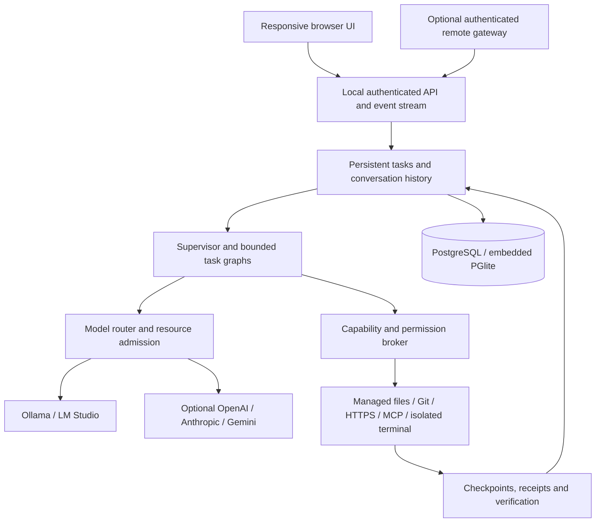

# Relay

### AI that works on your computer, under your control.

Relay is a local-first AI execution platform with a browser interface. Give it an objective, choose its access and budget, and follow the work from model selection through tools, approvals, changes and verification.

Run it with local models alone, or explicitly connect cloud providers. Your host remains responsible for permissions, resource admission and execution. Remote access is optional.

**Models propose. The orchestrator decides. Tools execute. Reality verifies.**

[Get started](#get-started) · [User guide](docs/user-guide.md) · [Architecture](docs/architecture.md) · [Security](docs/security-model.md) · [Validation](docs/validation.md)

> **Project status:** Relay is a working, actively developed application. The repository includes persistent tasks, local inference, controlled tools and a responsive interface. Some host integrations and deployment paths still need native validation; arbitrary native command execution and signed installers are not available. See [Current boundaries](#current-boundaries) before choosing a deployment.

## What you can do

| Workflow | What Relay provides |
| --- | --- |
| Have a conversation | Stream answers, reopen saved conversations, search history and navigate older messages. |
| Work on a project | Import a managed copy, authorize file tools, inspect changes and restore recorded checkpoints when safe. |
| Coordinate agents | Use bounded worker, planner, specialist and reviewer graphs. Agents and their assigned models are separate concepts. |
| Choose available intelligence | Discover Ollama and LM Studio models; optionally connect OpenAI, Anthropic or Gemini APIs. |
| Respect the computer | Inspect real hardware, assess model fit, reserve memory headroom and collect local performance samples. |
| Inspect execution | Follow factual activity, tool requests, approvals, model assignments and verification receipts. |
| Research with controlled tools | Allow selected public HTTPS origins, inspect managed-workspace Git changes, or pin approved MCP tool contracts. |
| Share a host deliberately | Configure an optional authenticated remote gateway, then grant each user specific models, workspaces, budgets and capabilities. |

No cloud account is required. Local inference needs a running supported runtime and an installed model; Relay does not ship model weights.

## Get started

### 1. Get the project

Clone [YardenNitsan/Relay](https://github.com/YardenNitsan/Relay), or download and extract its source archive. Open a terminal in the `Relay` directory.

```sh
git clone https://github.com/YardenNitsan/Relay.git
cd Relay
```

### 2. Start Relay

**Windows** — run [setup.cmd](setup.cmd), or double-click it:

```powershell
.\setup.cmd
```

**Linux / macOS** — run [setup.sh](setup.sh):

```sh
sh setup.sh
```

For a new host, the shared setup prepares dependencies and compiled assets before starting the local service. An already-running Relay host is reused without rebuilding or interrupting its tasks; stop it before applying pending source updates. Setup can prepare a project-local Node.js runtime when a suitable Node installation is missing. Initial setup needs Internet access to download missing dependencies; a prepared installation can operate offline with local models.

The browser address is **http://127.0.0.1:4317**. Setup opens the browser and a protected file containing a one-use pairing code. Enter the file's `token` value in **Connect this browser**. The code expires after five minutes; the resulting local browser session lasts up to twelve hours. A public URL or an open local port is not an owner credential.

| Command | Purpose |
| --- | --- |
| `setup.cmd --check` / `sh setup.sh --check` | Diagnose prerequisites without installing, building, starting or pairing. |
| `setup.cmd --no-browser` / `sh setup.sh --no-browser` | Prepare/start Relay and report the URL and private pairing-file location without opening windows. |
| `setup.cmd --stop` / `sh setup.sh --stop` | Gracefully stop a host started by setup. Separately launched hosts must be stopped through their own terminal or service manager. |

For a restart, stop the setup-managed host and run setup again. **Stop all agents** in the browser stops work; it does not shut down the host service. [Setup behavior, prerequisites and validation →](docs/setup.md)

<details>
<summary>Manual setup with an existing Node.js 24+ installation</summary>

```sh
npm ci
npm run build
npm start
```

Keep that terminal open. In a second terminal in the same directory:

```sh
npm run pair
```

Open the private file reported by the pairing command, then enter the code at http://127.0.0.1:4317. The command reports a file path rather than printing the credential. Use `Ctrl+C` in the host terminal to shut down gracefully. On Windows, use `npm.cmd` if PowerShell blocks the `npm.ps1` launcher.

</details>

### 3. Make a local model available

Start **Ollama** or **LM Studio** with an installed model, then open **Models & providers** in Relay. Refresh discovery, inspect the model and select **Check hardware fit**. Tool work requires a model that reports tool-calling support.

Relay does not automatically install runtimes or download models. Pick a model appropriate for your available memory; a model's weight-file size is only part of its memory requirement. [Local inference details →](docs/local-inference.md)

### 4. Send an objective

Start with **Auto model**, **Balanced**, **Read only** and **Local only**:

> Explain how this platform separates an agent from a model.

For file work, choose a workspace and import a managed copy first. Select **Supervised**, then try a small, checkable objective:

> Read the README, identify one unclear setup instruction, and propose a focused correction. After approval, make the change and read the file back.

Open **Activity** to inspect what actually happened. Its **Changes** and **Verification** tabs distinguish recorded modifications and tool evidence from the model's answer. Your original source directory is not modified by the managed-copy workflow.

## How Relay works



The host is a **TypeScript modular monolith on Node.js**, with Fastify for HTTP and server-sent events. The frontend uses React, TypeScript and Vite. Windows, Linux and macOS host adapters handle platform-specific hardware, data directories and secret storage.

By default, backend-local **PGlite** provides PostgreSQL persistence without a separate database service. Set `DATABASE_URL` to use native PostgreSQL. Messages, tasks, steps, calls, approvals and events have structured records; large artifacts and managed workspaces live on disk. Complete history is separate from the bounded context sent to a model.

The orchestration core constructs and validates task graphs, accounts for budgets, records decisions and propagates cancellation. A model cannot grant itself tools, broaden a workspace, disable logging or override emergency stop. [Architecture and decisions →](docs/architecture.md)

## Control the work

| Control | Meaning |
| --- | --- |
| **Fast / Balanced / Deep / Maximum** | Choose the scope of worker, planning, specialist and review work within explicit limits. More depth can take longer and use more model calls. |
| **Auto model / selected model** | Route over currently available, authorized models. A selected model is a preference; safety checks and availability still apply. |
| **Read only / Supervised / Autonomous workspace** | Set the ceiling for computer operations within an authorized managed workspace. |
| **Local only / Ask before sharing / Allow cloud providers** | Decide whether selected context may leave the host for cloud inference. Connecting a provider alone does not grant this. |
| **Execution options** | Bound calls, time, iterations, context and cloud cost; independently configure network origins and MCP access. |
| **Stop all agents** | Latch a host-side stop, cancel managed work and prevent new scheduling until the owner resumes Relay. |

Hardware admission considers RAM, dedicated or unified GPU memory, model weights, KV cache, runtime buffers, concurrent pressure and safety headroom. Missing measurements remain unknown. A safety pause is a meaningful outcome, not a reason to ignore memory limits.

## Security and privacy

- **Local by default.** Cloud providers and remote access are optional. No Internet service is required for an already prepared local installation and local inference.
- **Authenticated localhost.** One-use owner pairing, expiring cookies, origin/Host validation and CSRF protection guard the local API. The service binds to loopback.
- **Separate permissions.** Account grants, task computer access, cloud sharing, network origins and MCP selections are checked independently on the host.
- **Protected credentials.** Provider keys stay in the backend after entry. Supported OS vaults are Windows Credential Manager, macOS Keychain and Linux Secret Service; explicit session-only storage is also available. Keys are not returned in model catalogs or stored in ordinary database fields.
- **Controlled execution.** Structured tools pass through deterministic policy. Terminal tools require a verified Docker isolation boundary; there is no fallback to unrestricted host shell execution.
- **Untrusted content stays untrusted.** Documents, files, web responses, MCP catalogs and tool results do not become policy authority. These boundaries reduce risk; they do not make arbitrary external text or remote services trustworthy.
- **Recoverable records.** Changes, approvals, events and checkpoints persist. Interrupted actions with uncertain effects require inspection rather than automatic replay.

Remote deployment uses a separate authenticated listener behind Cloudflare Tunnel and Access. **Never expose the owner port, database, model-runtime ports or Docker socket to the Internet.** The remote listener is part of the same host process, not a separate OS security boundary. [Remote setup and threat model →](docs/remote-access.md)

## Current boundaries

Relay's implementation and its validation coverage are different things:

| Area | Current boundary |
| --- | --- |
| Host platforms | Shared core and Windows/Linux/macOS adapters exist. Windows has direct application validation; Linux has recorded native WSL validation of an earlier snapshot. Native macOS and the current cross-platform release still require verification. |
| Packaging | Portable OS archives and startup templates exist. Signed native installers, notarization and automatic updates are not delivered. |
| Computer control | Managed copies and owner-confirmed [direct host file operations](docs/host-access.md) are implemented. Arbitrary native commands remain unavailable; terminal execution stays isolated. |
| Terminal / native database | Isolation and native PostgreSQL paths have implementation and deterministic coverage; consult the validation ledger for actual native integration evidence. |
| Local inference | Ollama has actual-host execution evidence. Hardware fit is conservative admission, not a peak-memory guarantee; calibration is a bounded throughput sample, not a model-quality benchmark. |
| Cloud / remote / MCP | Adapters and policy enforcement exist. Live credentialed cloud acceptance, public remote deployment and broad external MCP interoperability remain to be validated. MCP currently supports constrained anonymous public HTTPS only. |
| Retrieval | Local full-text history search and bounded retrieval from the current conversation exist. Semantic embeddings, automatic conversation summaries and arbitrary cross-project memory are not implemented. |
| Attachments / tools | UTF-8 text attachments and managed project copies are supported. General image/PDF workflows, browser automation and arbitrary host application control are not implemented. |

See the [validation ledger](docs/validation.md) for dated results and the [project report](docs/project-report.md) for remaining work. Deterministic test providers are used in ordinary tests and are not represented as real inference.

## Develop and verify

| Command | Purpose |
| --- | --- |
| `npm run dev` | Start the watched backend. |
| `npm run dev:web` | Start Vite in a second terminal. |
| `npm run check` | Strict TypeScript checks and deterministic backend/security tests. |
| `npm run build` | Build the browser and host bundles. |
| `npm run test:e2e` | Real-browser tests against an isolated host with explicit test providers; build first. |
| `npm run test:e2e -- --config playwright.production.config.ts` | Inspect the already-running actual host using native owner pairing. |
| `node scripts/acceptance.mjs` | Run an actual installed Ollama model through the managed-workspace acceptance workflow. |
| `npm run package` | Produce portable Windows, Linux and macOS archives and checksums. |

Browser tests use Chrome by default. `PLAYWRIGHT_CHANNEL=chromium` selects an installed Playwright Chromium browser. Actual-model tests are separate because they depend on available models, host memory and runtime behavior.

## Documentation

| Start here | Engineering detail |
| --- | --- |
| [User guide](docs/user-guide.md) | [Architecture](docs/architecture.md) · [API contract](docs/api-contract.md) |
| [Setup, data and operations](docs/operations.md) | [Security model](docs/security-model.md) · [Security research](docs/research-security.md) |
| [Local inference and memory](docs/local-inference.md) | [Calibration](docs/calibration.md) · [Durable budgets](docs/adr-014-durable-execution-budgets.md) |
| [History and search](docs/history.md) | [Controlled MCP](docs/controlled-mcp.md) · [HTTPS and Git tools](docs/research-and-git-tools.md) |
| [Remote access](docs/remote-access.md) | [Frontend research](docs/frontend-research.md) · [Design system](docs/design-system.md) |
| [Validation evidence](docs/validation.md) | [Product requirements](docs/product-spec.md) · [Implementation plan](docs/implementation-plan.md) |
