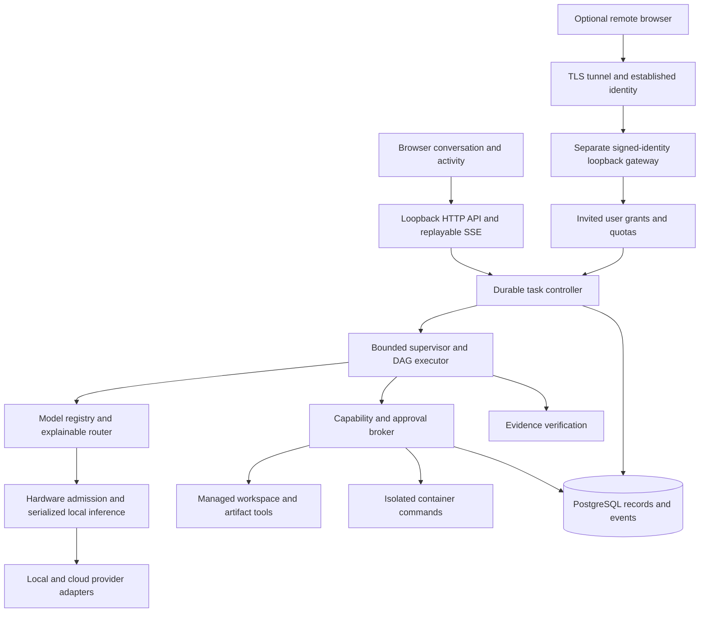

# Architecture and decisions

Research date: 2026-10-04. Source details are in `research.md`; these decisions describe the implemented core. `validation.md` records unimplemented capabilities and unverified platform guarantees.

## ADR001: TypeScript modular monolith

Node 24, Fastify and strict TypeScript provide cancellable streaming IO, subprocess supervision, runtime schemas and a shared browser contract. Python/FastAPI is strong for in-process ML; Relay delegates inference to existing runtimes, so a second language and environment do not currently justify their operational cost. Modules remain separate: persistence, events, orchestration, providers, resources, tools and API.

## ADR002: PostgreSQL with an embedded local option

Native PostgreSQL is supported through `DATABASE_URL`. A local single-service install defaults to ElectricSQL PGlite: the actual PostgreSQL engine persisted on the backend filesystem, not browser storage. It avoids requiring an unavailable Docker daemon or machine-wide database service. PGlite is single-connection: serialize transactions and use one service process; do not claim multi-process queue semantics. Parameterized SQL and migrations are compatible with native PostgreSQL. Native deployments use a dedicated database role. SQLite was simpler operationally but would diverge from the requested PostgreSQL/pgvector path. Current context uses bounded recent messages, task findings and saved step context; semantic retrieval and history summarization remain unimplemented.

## ADR003: Small custom execution core

LangGraph provides persistence/checkpoint and interrupt primitives; PydanticAI and Microsoft Agent Framework offer agent workflows; CrewAI Flows support event-driven state. They do not replace OS policy, resource admission or a product-specific durable tool ledger. The initial bounded DAG and role loops are small enough to own, avoiding framework state parallel to application records. Explicit states, persisted graph steps and bounded retry rules are prerequisites. No claim of exactly-once external effects: uncertain interrupted operations pause for inspection.

## ADR004: Same-origin HTTP and SSE

Commands use validated HTTP mutations. Ordered persisted events stream over SSE with event IDs, heartbeat, reconnect/replay and bounded batches. Browser websocket bidirectionality is unnecessary. Host/origin checks, strict HttpOnly session cookies and a per-session mutation CSRF token protect the local service against hostile browser origins. Local owner sessions require a five-minute single-use pairing code delivered through OS-account-protected storage; unpaired native loopback requests cannot bootstrap owner authority. The remote gateway has a separate signed-identity boundary. See [pairing security and native platform limits](security-model.md).

## ADR005: Tools cannot borrow host authority

Files operate in service-managed workspace snapshots. Source imports exclude secrets, links, Git internals and large/generated trees. Mutations create content checkpoints and reviewable diffs. Source repositories are not automatically modified. Terminal uses a fixed trusted Node 24 supervisor in a Linux container, with a read-only helper mount and bounded stdin snapshot input. Agent writes occur only in size/inode-limited tmpfs; there is no writable host workspace mount. The supervisor drops worker UID/GID and capabilities, verifies seccomp/no-new-privileges, terminates remaining workers and exports a bounded snapshot for host validation and checkpointing. Network, root-filesystem writes, persistent container logs and provider environments are disabled. Aggregate host storage admission is separate from kernel container limits. Real Docker enforcement remains unverified; unavailable daemon/image/preflight means no host fallback. See [implemented command security and validation limits](research-security.md). Windows AppContainer/Job Objects and Linux bubblewrap/cgroups remain potential native brokers. Unrestricted host autonomy stays disabled until independently validated.

Structured `http_get` has separate public-origin authorization and DNS/TLS pinning. `git_status` and `git_diff` use installed Git against managed Relay baselines without source repository configuration. Controlled `mcp_call` uses the official SDK with owner-pinned tool catalogs, scoped server/network grants and exact-operation approval. Descriptions and remote results remain untrusted context. See [research/Git](research-and-git-tools.md) and [MCP boundaries](controlled-mcp.md).

## ADR006: Provider and resource boundaries

Ollama native discovery/metadata/streaming is the first real local path. Model metadata includes provenance, unknown values and measured usage. Conservative admission includes model weights, architecture-derived KV cache where available, runtime buffers, requested context, host pressure and safety reserves. Serialize local generations initially. Do not unload models not owned by Relay. Cloud adapters use fixed official endpoints and server-side OS keyring/environment credentials. No silent cloud fallback or credential logging.

## ADR007: Browser stack and design

React + TypeScript + Vite; server state is distinct from transient view state. The browser is a client app with no SSR need. Semantic HTML/native controls and accessible dialog primitives keep the dependency set focused. Markdown disables raw HTML. Large work logs are bounded/paginated; diffs load when opened. Custom tokens and purposeful typography avoid a stock dashboard. No hosted Sites runtime can replace the privileged local service.

## ADR008: Shared host with explicit OS integrations

The core targets Node.js 24 on all three operating systems. WindowsHost, LinuxHost and MacOSHost provide native data conventions and credential backends. Hardware collection uses cross-platform systeminformation, with unified memory as a distinct budget architecture. Structured file operations are portable. Commands require a verified Linux-container boundary; no platform is silently granted host-shell execution. Separate portable packages include appropriate per-user startup templates. Native installer signing and OS-specific sandbox implementations are release work, not equivalent guarantees inferred from portable code.

## ADR009: Optional authenticated remote listener

The initial supported public architecture is Cloudflare Tunnel + Access, with signed JWT verification repeated by the host. A separate loopback listener receives only gateway requests and cannot bootstrap a local owner. Local port 4317 remains independent. Tailscale is a useful private-network alternative, but its identity headers require a different verified adapter; arbitrary forwarded headers are not trusted. Users, sessions, conversations and tasks have explicit ownership. Remote grants independently restrict providers, workspaces, access and budgets. The local owner alone manages secrets, users and global stop. Separate OS process identities would strengthen isolation in a future distribution.

## ADR010: Fail closed on unknown evidence and cost

A model's confidence is never a passing test. Actual tool checks have stable identities and an ordered ledger; successful repair supersedes an earlier failure without deleting history. A response without external verification is labelled generation-only. Interrupted side effects require inspection. Cloud costs are reserved atomically before requests; unknown usage retains its reservation. A strict budget rejects unknown model prices. This sacrifices availability where metadata is missing in exchange for honoring the owner's boundaries.

## ADR011: Constrained adaptive planning and durable repair

Deep and maximum execution can adapt the specialist graph after planning. The planner proposes only a list of permitted specialist roles, acceptance criteria and a short justification. A strict schema rejects extra fields, privileged/duplicate roles and roles outside the selected depth. The core constructs all dependencies and retains the worker and final reviewer. Invalid proposals keep the original bounded graph. The proposal decision and resulting graph are committed together and are not regenerated on resume.

Balanced and deep tasks permit at most two automatic repair rounds; maximum permits three and fast permits none. Repairs preserve worker tool receipts and append review/check feedback, reset the reviewer, and consume the same task call/time/cost budgets. The round count persists across restarts. Denied capabilities and ambiguous interrupted effects do not become retry invitations. A review must end with an explicit passing verdict, which remains a model assessment; unresolved actual checks prevent completion independently. Failure of a parallel branch cancels and joins siblings before releasing the task slot.

This follows the useful orchestrator/worker and evaluator/optimizer patterns in [LangGraph's workflow documentation](https://docs.langchain.com/oss/javascript/langgraph/workflows-agents), while retaining Relay's normalized evidence, policy and execution authority. It is bounded adaptive planning, not arbitrary model-authored executable DAGs or unrestricted debate.

## ADR013: Explicit required evidence

Authenticated callers may add bounded `verification.requiredReads` predicates to task options. Each binds a permitted relative path to an expected whole-file SHA-256. Actual successful broker read receipts after the latest workspace change satisfy the contract; model prose cannot. A missing predicate causes bounded factual continuation and prevents the final assistant message. Database completion independently checks these predicates. See [ADR013](adr-013-required-verification-contracts.md) for failure behavior, shared-workspace invalidation and the API-only scope of initial contract declaration.
