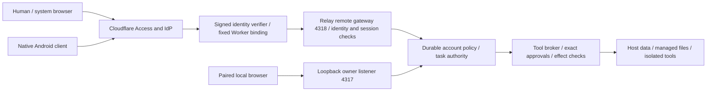

# UI, agents and Android threat model

Date: 12 October 2026. Audited source: `fda18f490d30befc66be88f25bad4e5f44c49b5d`. Initial status was source/document review with read-only toolchain checks. A later authorized native increment has actual build, JVM and disconnected-emulator evidence in [Android validation](android-validation.md). No penetration test, production authentication experiment, authenticated native-host acceptance or exploit reproduction was performed. Findings distinguish existing behavior from risks introduced by the proposed native client. See [Android architecture](android-architecture.md) for dependency and authentication research.

## Assets and boundaries

Assets are host/account identity; Access and Relay session credentials; provider secrets; conversations and attachments; private workspaces and original-source files; exact approval receipts; durable event ordering; model/tool budgets; and the ability to stop or revoke execution. The phone is a client, never the authority for account grants or local-owner access.



Cloudflare terminates public TLS; the host operator can access host data. Neither this architecture nor native token encryption provides end-to-end encrypted inference or protection against a compromised host administrator. Rooted-device/app-process compromise remains outside token-at-rest protection. Untrusted model output, repository text, tool responses, filenames and attachments may influence displayed content but cannot authorize actions.

## Verified protections and integration findings

| ID / assessment | Concrete source evidence | Risk and required disposition |
|---|---|---|
| SEC-01: existing positive control | `deploy/cloudflare/worker.ts:32`, `:38`, `:108`; `server/auth/remote.ts:36` | Fixed public origin/VPC destination, strict route filtering and repeated signature/issuer/audience/type validation protect the public path. Retain them for Android; service credentials and arbitrary forwarded email are not human login. |
| SEC-02: existing positive control | `server/auth/sessions.ts:22`, `:35`, `:64`; `server/api/app.ts:99` | A signed Access identity is required per remote request, and private APIs also require the matching Relay cookie. Session version, enabled/approved state and mutation CSRF are checked. Tokens are hashed server-side; cookie is Secure, HttpOnly, Strict and path `/`. |
| SEC-03: native readiness blocker, not a discovered exploit | `deploy/cloudflare/worker.ts:18`, `:109`; `server/auth/remote.ts:40` | Existing code expects a signed human application JWT; an opaque OAuth access token is not that JWT. The edge must resolve it into the existing assertion. Compatibility is documented by the vendor in principle but unverified here. Do not weaken verifiers to force success. |
| SEC-04: callback ownership blocker | `deploy/cloudflare/worker.ts:38` | `/.well-known/assetlinks.json` is not routed by the Worker; all forwarded requests require identity. Verified Android HTTPS callbacks need a publicly fetchable domain association and package signing identity. Design separate static association hosting, without exposing Relay API paths or adding Access bypass rules. |
| SEC-05: uncertain mutation replay risk | `server/api/app.ts:207`, `:216`; `server/db/store.ts:76` | Initial conversation creation compares a request ID and payload; follow-up messages do not have a caller idempotency key. Automatic POST retry after a lost response can create a duplicate later, once the original task is no longer active. Use read/reconcile and deliberate retry; implement a durable idempotency contract before claiming safe mobile outbox delivery. No duplicate was reproduced in this audit. |
| SEC-06: existing lifecycle distinction | `server/auth/sessions.ts:68`; `server/api/app.ts:398`, `:403`, `:406` | Logout/session deletion removes session access; individual session revocation does not necessarily cancel work already admitted under durable user authority. Account revoke/stop is stronger. Native UX must not claim signing out stops agents or permanently bans an otherwise authorized Access user. |
| SEC-07: replay namespace is not authorization | `server/api/activity-replay.ts:9`, `:15`; `server/api/app.ts:333` | Scope changes with Store/session/account version and invalid cursors reset. Account filters and live sessions remain mandatory. An Android cursor stored ahead of applied state can skip data after process death; persist state/cursor together or reset. |
| SEC-08: actual stream limits and expiry | `server/api/app.ts:74`, `:337`, `:343`, `:366` | Four streams per user/32 per Store, signed-token expiry timer, session checks and backpressure bound resource use. Multiple ViewModels must not create uncontrolled streams; backoff and single-flight refresh prevent reconnect storms. |
| SEC-09: no remote owner authority | `server/auth/remote.ts:88`; `server/auth/policy.ts`; `deploy/cloudflare/worker.ts:42` | Remote owner bootstrap, owner pairing, global stop/resume and owner configuration are denied. Do not add an "owner phone" shortcut, export pairing codes, or expose blocked routes to achieve feature parity. |
| SEC-10: layered expiry behavior, defense-in-depth observation | `server/auth/remote.ts:40`; `deploy/cloudflare/worker.ts:116` | Host JOSE validation uses five-second tolerance; Worker additionally rejects `exp <= now` and future/invalid issued-at. The supported public path retains the stricter Worker check. This is not a demonstrated public bypass; preserve expiry-negative tests on both layers and consider aligning host validation in a separately scoped change. |
| SEC-11: logging protection to preserve | `server/api/app.ts:85`; Worker failure responses | Known session, Access, CSRF, pairing and provider secret fields are redacted; Worker errors omit upstream exception text. New Android logging, OAuth URLs and diagnostics introduce new possible leak surfaces. Disable body/header logging and sanitize callback URIs. |
| SEC-12: capability/rendering integrity | `shared/types.ts`, `shared/assistants.ts`, `server/auth/policy.ts`, `server/api/app.ts:164` | Profiles, DAG roles, model selection and grants are different concepts. A mobile card or agent-supplied claim must never grant tools or imply confirmed execution. Render permission and evidence from server records. |

Existing test sources inspected include `tests/auth.test.ts`, `tests/cloudflare-worker.test.ts`, `tests/session-lifecycle.test.ts`, `tests/activity-replay.test.ts`, `tests/remote-api.test.ts`, and `tests/remote-registration.test.ts`. Their existence and assertions were inspected; this audit does not report a new pass count. Some remote API tests use an injected identity fixture, while Worker and identity tests exercise signed JWTs; neither is live Cloudflare acceptance.

No newly demonstrated exploitable authorization bypass was established by this review. That is a bounded statement about this audit, not a security certification. The blockers above must not be hidden behind an APK build claim.

## Proposed Android security requirements

**Credential boundary.** Use system-browser OAuth with public-client PKCE and state; no embedded IdP login, service secret, browser-cookie scraping or exported provider key. Store long-lived refresh tokens and any persisted session material as authenticated ciphertext protected by Android Keystore keys in app-private storage. Keystore protects keys, not arbitrary plaintext token strings automatically. Treat hardware backing as observed capability rather than guaranteed on every device. Keep access tokens/CSRF in memory where practical and bound their retention. [Android Keystore](https://developer.android.com/privacy-and-security/keystore)

**Transport boundary.** Release builds permit HTTPS only and use platform certificate/hostname verification. Never implement trust-all TLS or silently accept an invalid LAN certificate. Restrict credential-bearing requests to the configured origin, reject redirects to a different authority, and keep OAuth issuer requests in a separate credential context. Debug trust anchors belong only in debug configuration. Certificate pinning is not assumed necessary for a third-party edge with rotating certificates; if later selected, require backup pins and rotation testing. [Network Security Configuration](https://developer.android.com/privacy-and-security/security-config)

**Device data boundary.** Exclude credentials, cookies, pending auth transactions, private conversation caches and encrypted data requiring non-restorable keys from cloud backup and device transfer. An `allowBackup` flag alone is not a complete transfer-policy analysis across versions/manufacturers; test extraction rules and restore behavior. Initial implementation should avoid retaining whole transcripts offline. Optional protected drafts are partitioned by host and account, never reused after an account switch. [Android backup rules](https://developer.android.com/identity/data/autobackup)

**Intents and files.** Export only the launcher and narrowly scoped verified auth callback. Check complete callback scheme/host/path plus transaction state. A deep link can select an identifier but cannot approve, cancel, publish or execute a tool. Reauthenticate and fetch current ownership before opening private content. File imports use system-picker grants, byte limits and content validation. Never trust a display filename as a filesystem path or forward secrets from phone storage automatically.

**Presentation boundary.** Agent/model text and repository content remain untrusted. Render bounded native text/Markdown with no active HTML, JavaScript bridge or automatic external fetch. Require deliberate external link navigation and deny executable schemes. Exact-action approval shows operation, current task identity, arguments, scope, model provenance where known, and meaningful deny/cancel controls. A model saying "approved" is ordinary content. Avoid exposing content in notification previews, crash reports, Recents thumbnails or clipboard by default; provide explicit copy controls and document device-level screenshot limitations.

**Revocation and concurrency.** Account change creates a new session epoch, cancels old requests/streams and discards late responses before UI reduction. Refresh is single-flight; logout cannot race a delayed refresh into resurrecting credentials. A connectivity failure leaves a draft and an unknown delivery state; it cannot become a synthetic success or automatic approval. Closing the client never implies host cancellation. One global app stream is sufficient for the initial client.

**Build supply chain.** Pin Gradle distribution/checksum and dependency versions, enable dependency verification, restrict repositories, inspect licenses, and keep signing keys outside source/build logs. Release must be non-debuggable with no fixture auth switch, test CA, debug endpoint or service credential. Android skills are external development inputs: review specific files/scripts at a pinned commit, never execute fetched instructions merely because a repository claims official provenance.

## Required verification plan

The following is a plan, not completed acceptance. Each test needs a named environment, expected refusal/success, evidence location and actual result. Record secrets only as redacted metadata, never as JWTs/cookies, callback URLs or token hashes that can be mistaken for safe audit identifiers.

| Test group | Required cases / expected evidence |
|---|---|
| Existing host/gateway regression | Run focused auth, Worker, remote API/registration, session lifecycle and activity replay suites after changes; then required repository checks. Preserve negative tests for wrong key/algorithm/issuer/audience, service JWT, expired token, forged email, remote pairing, owner routes, wrong/missing Origin, CSRF and cross-account IDs. |
| Managed OAuth staging | Approved/uninvited/pending/disabled users; public-client PKCE; wrong verifier; wrong resource/issuer; expired/replayed code; bad callback URI; missing/tampered state; no client secret; policy rejection on refresh. Verify edge assertion is accepted unchanged by both existing verifiers and no access token reaches host logs. |
| Callback domain | OS association fetch succeeds without Relay credentials on the separate static host; exact release package/certificate matches; unverified association fails closed; wrong app cannot steal usable callback credentials; no Relay API is reachable through that host. |
| Account/session binding | Access identity A plus Relay cookie B fails; switching host/account clears private views; late old responses do not repopulate UI; revoked session fails HTTP and existing SSE; account disable stops/revokes according to current host semantics; re-login does not inherit prior account drafts or cached data. |
| Refresh/logout races | Concurrent 401s start one refresh; timeout does not loop indefinitely; logout during refresh wins; lost logout response reports uncertainty; expired refresh requires browser auth; redirected API response never leaks bearer/cookie to another host. |
| Stream parser/replay | Arbitrary byte/chunk boundaries, malformed/oversized data, unknown event types, duplicate/reordered delivery, Store restart, stale scope, future cursor, app kill between parse/apply/commit, account switch, expiry under backpressure, 429 and network handover. Compare resulting state with a fresh server snapshot. |
| Mutation integrity | Initial create retry returns the original task for exact ID/payload; changed payload conflicts. Lost follow-up/approval/cancel/file-edit responses trigger reconciliation with no blind retry. Approval cannot apply to a different task or newer operation. Stale expected hashes refuse writes. |
| Authorization at effects | Use existing durable broker regression fixtures for revoke/stop while queued and immediately before file effects. A UI redesign or native call must not bypass the broker or turn a display capability into execution permission. |
| Device storage/transport | Inspect release manifest/exported components/backup rules/network config; verify private token storage and backup/restore cleanup, invalid TLS refusal, no plaintext token in logs/files/screenshots/crash reports, no release debug trust anchors. |
| Untrusted display | Hostile Markdown, link schemes, very long filenames, bidi/control text, injected approval instructions and forged success claims stay inert; paths/hashes remain inspectable; no hidden text changes the real submitted approval. |
| Real device | Browser-to-app return, login, task start, stream, exact approval, cancel, lock/unlock, process death, mobile/Wi-Fi handover, airplane mode, host offline/restart and revoked account. Measure rather than infer background delivery. |
| Artifact/release | Clean pinned build; unit and instrumented tests; signed APK verification and checksum; install/upgrade on physical device; no credentials or fixtures in APK; secret-safe CI signing and retained provenance. A debug APK is not a production release. |

Candidate existing focused command (not run by this audit):

```powershell
npm.cmd test -- tests/auth.test.ts tests/cloudflare-worker.test.ts tests/session-lifecycle.test.ts tests/activity-replay.test.ts tests/remote-api.test.ts tests/remote-registration.test.ts
```

Follow the repository's authoritative `AGENTS.md` for final integrated commands. Native `lint`, unit/instrumented test and APK assembly commands can only be recorded as verified after the project exists and they execute successfully.

## Residual risks and release blockers

The current host remains a high-value shared process, and an OS administrator or compromised host can see secrets and content. Access/IdP revocation latency differs from Relay account/session revocation; enforce the latter independently. OAuth Beta behavior, callback domain control and signing ownership need live proof. A stolen unlocked/rooted phone can access an authorized account; at-rest encryption does not stop an active compromised process. Background execution/notification guarantees depend on Android policy and are not implemented by adding SSE. Protocol drift between independently updated host and APK requires compatibility policy. Reliable general mobile mutation retries need additional server idempotency contracts.

These are explicit delivery constraints. None justifies weakening Access, publishing an alternate unprotected API, reusing owner pairing, distributing shared service secrets or treating the debug APK as authenticated remote or production-release acceptance.

## Implemented LAN preview evidence and review

The subsequent authorized implementation is under `android/`; [Android validation](android-validation.md) records the actual debug APK, version/hash/public signing fingerprint, exact commands and residual tests. The initial architecture sections above remain requirements for the larger remote product.

Implemented controls include system-trusted HTTPS only, exact-origin cookie/CSRF transport without redirects or automatic mutation retries (`RelayClient.kt`), host-only Secure/HttpOnly cookie validation, Keystore AES-GCM origin-bound storage (`SessionVault.kt`, `Protocol.kt`), backup/transfer exclusions and unconditional secure activity windows. Session epochs guard UI updates and cancellation; client closure is permanent with synchronized cookie updates to prevent late callbacks restoring an old client's credentials. Logout removes local session state and accurately reports when host revocation cannot be confirmed.

Independent review found missing secure windows and insufficient approval scope/provenance. Both were corrected: `MainActivity.kt` sets `FLAG_SECURE`, and approval review shows exact host origin, durable task ID/objective, task workspace ID/name, exact arguments and model identity from events before the proposal. Unknown provenance is labeled unknown. `cloud_egress` explicitly describes content leaving the host, provider retention and possible authorized cost. `ApprovalContext.kt` tests exclude future reroutes and other tasks. The server's descending task order now selects the newest task on automatic inspection.

Final native verification passes12 JVM tests and lint with0 errors/6 warnings; final APK install/cold launch and secure-window flag/screenshot blocking were observed on API36.1 emulator. This does **not** establish authenticated native-host behavior, production Cloudflare auth, physical-phone privacy, Android37 permission UX, full transport/late-response race coverage or dependency supply-chain verification. Full Gradle transitive verification metadata is explicitly deferred pending reviewed provenance; wrapper/distribution hashes are verified and enforced. These remain acceptance/release gates, not silently completed requirements.

A later test-only increment adds seven passing real loopback HTTPS tests of unchanged `RelayClient`: trusted Cookie/Origin/CSRF exchange, unknown CA, wrong SAN, cross-origin302/307 refusal, response-size limits, cancellation after headers and closed-client delayed-response cookie protection. In-memory test CA/DNS are injected only under `src/test`, without a production trust hook or OS trust change. See the additional transport section in [Android validation](android-validation.md). Actual ViewModel logout/account switching, platform trust/Keystore and authenticated-host/device acceptance remain open; a transport closure test does not prove all session-epoch races.

The subsequent complete native JVM rerun passes all19 tests across5 classes with0 failures/errors (exit0,7s). No assembly/runtime change or new APK was introduced by this security-test increment.

A later opt-in real-host integration passes20 tests across6 classes (exit0,18s), using actual Relay LAN HTTPS APIs, account policy, database, sessions, broker and task lifecycle. It verifies enrollment/replay rejection, restored CSRF, scoped reads, chat admission/cancel, real SSE replay, logout/revocation and deterministic expiry. Native invitation credentials and TLS keys remain in private pipes/memory. Real owner pairing also writes a protected temporary owner-pairing.json inside the fixture directory, removed during guarded cleanup. No production network/trust configuration changes are made. See [Android integration](android-integration.md) for exact boundaries: this closes the isolated JVM-to-backend gate, while device/system-trust, installed-app UI and remote Access gates remain open.

## Native0.2 data handling

The updated testing client encrypts unsent draft text/context/uncertainty with a distinct Keystore key, origin/account/conversation AAD and revision/epoch guards. Logout/revocation destroys the key and clears private UI. Backup/transfer exclusions already cover these preferences. File picking retains bounded data in memory until exact destination review; stale results are rejected and an unconfirmed upload cannot be transparently retried. Independent review found and corrected the concrete issues in [Android0.2 evidence](android-0.2.md).29JVM tests and an installed emulator launch are not physical Keystore/lifecycle or authenticated UI acceptance. Native remote and biometric gates remain open.

## 13 October private LAN trust and cleanup

Dedicated exact-IP HTTPS, isolated data/secret managers and unchanged server account/CSRF/Host boundaries were reviewed. Default/release native trust remains system-only; optional debug public CA applies only to10.100.102.30. Browser CA installation is an explicit device trust decision, with fingerprint/removal documented. No firewall/router/Cloudflare or production change occurred. Actual installed logout revealed main-thread TLS disposal; central off-main cleanup now clears credentials synchronously and serializes request admission against closure. Regression and installed Conscrypt verification pass. See [independent review](independent-review.md), [native evidence](../../android/lan-trust-build.md) and [remaining limitations](lan-local-setup.md).
